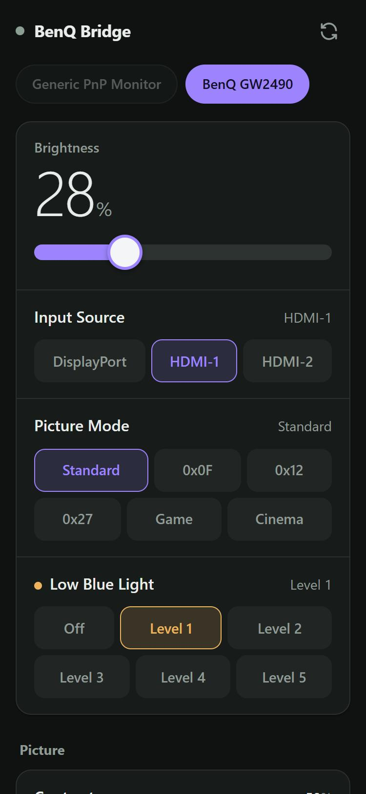

# BenQ Bridge

A local DDC/CI (MCCS) monitor controller with a mobile-friendly web UI.
It talks to your monitor directly through `dxva2.dll` — no BenQ software, no
driver, no cloud service, no telemetry.

Built by reverse engineering BenQ Eye-CareU, which turns out to be doing exactly
the same thing internally (`GetPhysicalMonitorsFromHMONITOR`, `GetVCPFeatureAndVCPFeatureReply`,
`SetVCPFeature`) but exposes only a curated subset of what the panel supports.

<p align="center">
  
</p>

## What it can do

Anything your monitor advertises in its MCCS capability string. On a BenQ GW2490
that is 33 VCP codes, including:

| Feature | VCP |
|---|---|
| Brightness, Contrast, Sharpness, Gamma | `0x10`, `0x12`, `0x87`, `0x72` |
| Picture mode | `0xDC` |
| Low Blue Light | `0x19` |
| BI / auto brightness | `0xE2`, `0x52` |
| Color preset, R/G/B gain | `0x14`, `0x16`, `0x18`, `0x1A` |
| Input source (DP / HDMI-1 / HDMI-2) | `0x60` |
| Volume, Mute | `0x62`, `0x8D` |
| Firmware / version words | `0xC9`, `0xC8`, `0xC1`, `0xC2` |
| Reset: factory defaults, colour defaults | `0x04`, `0x08` (hold-to-confirm button at the bottom of the UI) |

Features are discovered at runtime from the monitor, not hardcoded, so unknown
or newer codes still show up under **Advanced / raw VCP codes** instead of being
hidden.

## Requirements

- Windows 10/11
- DDC/CI enabled in the monitor's OSD (on by default for BenQ)
- To run the release: nothing else. It bundles the .NET runtime, so you do not need
  to install .NET.
- To build from source: the .NET 10 SDK

## Download and run

1. Download `BenqBridge-win-x64.zip` from the
   [latest release](https://github.com/samir-dahal/benq-bridge/releases/latest) and unzip it.
2. Run `BenqBridge.exe`. Keep the `wwwroot` folder next to it. There is no console window;
   the app lives in the notification area (the tray) as a small monitor icon.
3. Windows may show a SmartScreen warning because the exe is not code-signed. Choose
   **More info**, then **Run anyway**. Allow it through Windows Firewall on private
   networks when asked, otherwise your phone cannot reach it.
4. On the first run your browser opens a **Pair your phone** page with a QR code. Scan it
   with your phone's camera. The phone opens the controls already signed in, so there is
   no token to type.
5. Tick **Start with Windows** on that page so the app runs whenever you sign in.

The phone has to be on the same Wi-Fi as the PC. Paired phones stay paired across restarts,
because the token is saved on the PC and in the phone's browser.

### The tray icon

Right-click the icon for **Pair a phone**, **Open controls**, **Start with Windows** and
**Quit**. Double-clicking it opens the pairing page. Launching `BenqBridge.exe` again while
it is already running opens the pairing page too, instead of starting a second copy.

Closing the app by accident is harmless: start it again and every paired phone works
without pairing again.

### The token

Every request needs an access token, because the app can change your monitor's settings
and anyone on your network could otherwise do the same. The QR code carries the token in
the link's fragment (`#t=...`), which the browser never sends to the server, and the
page removes it from the address bar after saving it. The token is generated on the
first run and saved to `%LOCALAPPDATA%\BenqBridge	oken.txt`. Delete that file and the
next start generates a new token, which signs out every paired phone.

Started from a terminal, the app prints the same details there (a double-click shows no
console):

```
  BenQ Bridge 0.1.0
  ----------------------------------------------
  http://localhost:5080/
  http://192.168.1.42:5080/
  token: your-token-here
  ----------------------------------------------
  Pair a phone: http://localhost:5080/pair.html
```

You can also open a LAN URL on your phone by hand and enter the token once.

## Run from source

```powershell
git clone https://github.com/samir-dahal/benq-bridge
cd benq-bridge
dotnet run
```

## Options

| Argument | Env var | Default |
|---|---|---|
| `--port 5080` | `BENQ_BRIDGE_PORT` | `5080` |
| `--token abc` | `BENQ_BRIDGE_TOKEN` | generated, saved to `token.txt` |
| `--pair` | | open the pairing page on start (it opens by itself only on first run) |
| `--no-browser` | `BENQ_BRIDGE_NO_BROWSER=1` | never open a browser |
| `--install` / `--uninstall` | | add or remove the Start with Windows entry, then exit |
| `--stop` | | ask the running copy to quit, then exit |

## Build a release

```powershell
.\scripts
elease.ps1
```

The script builds from a fresh clone of the last commit, never from your working folder,
so internal files such as `private-artifacts/` and `token.txt` cannot end up in the zip.
It then checks that the output holds only `BenqBridge.exe` and web assets, scans it for
any pairing token found on your machine, and writes `dist\BenqBridge-win-x64.zip` with its
SHA-256. It uploads nothing; it prints the `gh release create` command for you to run.

## HTTP API

All `/api/*` and `/ws` requests need `X-Api-Token: <token>`
(WebSocket may use `?token=`).

| Method | Path | Body | Purpose |
|---|---|---|---|
| GET | `/api/health` | | liveness + monitor count |
| `GET` `/api/monitors` | | every display with all features and current values |
| GET | `/api/monitors/{id}` | | one display |
| POST | `/api/monitors/{id}/refresh` | | re-read capability string and all values |
| GET | `/api/monitors/{id}/vcp/{code}` | | direct read, `code` in hex (`10`, `0x10`) |
| PUT | `/api/monitors/{id}/vcp/{code}` | `{"value":25}` | direct write |
| WS | `/ws` | | pushes `{type:"state", monitors:[...]}` on every change |

`{id}` is the display device name without the `\\.\` prefix, e.g. `DISPLAY4`.

Each monitor object carries two flags:

- `ddcChannel` — Windows handed us a physical monitor handle, so DDC/CI commands can be attempted.
- `supported` — that channel exists **and** the monitor returned a usable capability string with features.

A display can therefore be `ddcChannel: true, supported: false`: the cable is fine but it
has not answered yet (asleep, OSD open). It is retried automatically every 10 s.

Examples:

```powershell
$h = @{ 'X-Api-Token' = 'your-token-here' }

# what does this monitor support?
Invoke-RestMethod http://localhost:5080/api/monitors -Headers $h | ConvertTo-Json -Depth 6

# brightness
Invoke-RestMethod -Method Put http://localhost:5080/api/monitors/DISPLAY4/vcp/10 `
  -Headers $h -ContentType application/json -Body '{"value":35}'

# switch to HDMI-1
Invoke-RestMethod -Method Put http://localhost:5080/api/monitors/DISPLAY4/vcp/60 `
  -Headers $h -ContentType application/json -Body '{"value":17}'
```

## Design notes

- **One semaphore per display.** DDC/CI takes 30–150 ms per transaction and is not
  thread-safe; every read and write is serialised.
- **Retries.** Reads retry 3× with 50 ms backoff, capability reads retry 3× with
  100 ms — the same strategy BenQ's own `Monitor.dll` uses.
- **Coalesced writes.** Dragging a slider sends the newest value only, never a
  queue of stale ones (see `pump()` in `app.js`).
- **Confirmation.** After a write the value is read back; the API returns
  `confirmed:false` if the panel ignored it, and the UI shows a toast.
- **Polling only while a client is connected** (`ActiveClients`), so idle cost is zero.
- **Self-healing capabilities.** A display that enumerates but has not answered the
  capability request yet (asleep, OSD open, cable still settling) is retried every
  10 seconds, and reported with `ddcChannel: true, supported: false` so the UI can
  say "not answered yet" rather than "no DDC".
- **`0x8D` mute is 1/2, not 0/1** and **`0xE2` is 0/255** — both encoded in
  `Ddc/VcpCatalog.cs`.

## Limitations

- Some displays (laptop internal panels, a few USB-C docks) expose no DDC channel;
  they are listed but marked unsupported.
- Reads fail transiently while the monitor's own OSD menu is open — retry or close the OSD.
- Text/HDR toggling is a *Windows* feature (`DisplayConfigSetDeviceInfo`), not DDC;
  it is deliberately not part of this API.
- BenQ-specific codes `0xEA/0xEB/0xEE/0xF0/0xF1/0xF8/0xFD` are exposed but their
  meaning is not yet identified.
- The PWA manifest only gets "install to home screen" treatment over HTTPS or
  localhost; over plain LAN HTTP, add the page to your home screen as a bookmark.

## Layout

```
BenqBridge.csproj
Program.cs              minimal API, auth, endpoints
WsHub.cs                websocket fan-out
Ddc/Native.cs           P/Invoke: user32 + dxva2
Ddc/Capabilities.cs     MCCS capability-string parser
Ddc/VcpCatalog.cs       VCP code -> name/kind/options
Ddc/DdcDevice.cs        one display: serialised read/write/poll
Ddc/MonitorRegistry.cs  enumeration, polling loop, DTOs
wwwroot/                mobile UI (vanilla JS, no build step)
```
